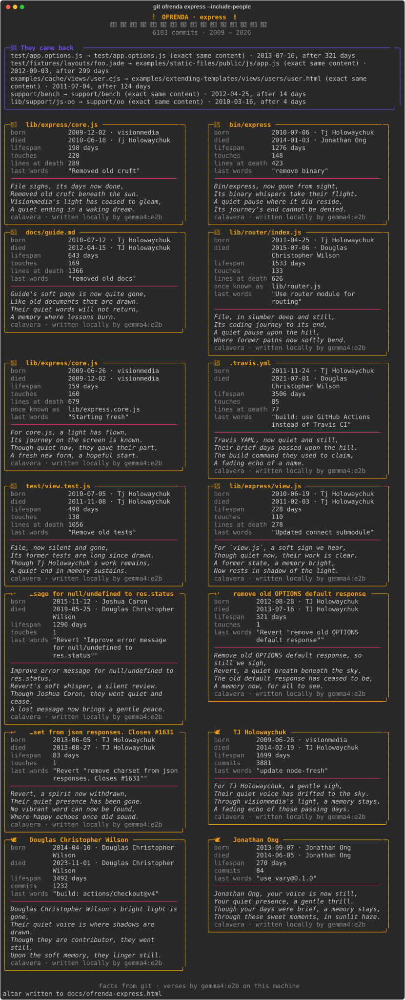

# git ofrenda 🕯️🌼

`git ofrenda` reads a repository's entire git history, finds what has died there (deleted
files, reverted commits and, if you ask, contributors who went quiet), notices what came
back from the dead, and builds a Día de los Muertos altar for them in your terminal and as
a single offline HTML page. A local open-weight model (Gemma 4 through
[Ollama](https://ollama.com)) writes a *calavera literaria* for each soul: a short, playful
memorial verse.



Sample HTML output (spooky edition: moon, bats, tombstones): [`docs/ofrenda-express.html`](docs/ofrenda-express.html) (open it in a browser).

## Install

```sh
pipx install git+https://github.com/quangvinhlee/Ofenda.git   # or, from a clone: pip install -e .
ollama pull gemma4:e2b
```

Python 3.11 or newer. The only runtime dependency is [`rich`](https://github.com/Textualize/rich).
Because the command is named `git-ofrenda`, git picks it up as a subcommand.

## Usage

```sh
git ofrenda                          # the repo you are in
git ofrenda -h                       # all options (`git ofrenda --help` asks git for a man page)
git ofrenda ~/src/express            # any repo
git ofrenda --top 12                 # more deleted files on the altar (default 8)
git ofrenda --include-people         # also mourn contributors who went quiet
git ofrenda --include-people --quiet-days 730
git ofrenda --lang es                # verses in Spanish
git ofrenda --html altar.html        # also write the altar as one HTML page
git ofrenda --ignore 'docs/*' --ignore '*.svg'   # skip more noise (adds to the defaults)
git ofrenda --no-ai                  # template verses only, no network at all
git ofrenda --model gemma3:4b-it-q4_K_M          # any Ollama model
git ofrenda --host http://192.168.1.20:11434     # Ollama on another machine
OFRENDA_MODEL=qwen2.5-coder:7b git ofrenda       # or set the model once
```

## What counts as a soul

| soul | how it is found |
|---|---|
| deleted file | a delete in `git log --raw`, with its history followed through renames |
| reverted commit | a commit titled `Revert "…"`, linked back to the commit it undid |
| quiet contributor (opt-in) | someone with 5 or more commits and nothing in the last `--quiet-days` (365) |

**Ghosts** are deleted files that came back. When a later commit adds a file whose blob hash
matches the deleted file's last blob, the content is byte-for-byte identical, so git itself
is the proof. A file that returns under the same name with new content is listed as
"same name, new body". Empty files never count as ghosts, and neither does a file that comes
back less than a day after it was deleted (that is a move split across two commits).

Lock files, minified bundles, source maps, snapshots and `node_modules/`, `vendor/`, `dist/`
and `build/` are skipped.

## Facts vs. verses

Every fact on the altar (dates, authors, lifespans, touches, line counts, last words) comes
straight from git. The model only writes the verse, it is told to use only the facts it is
given, and every verse is labelled with where it came from: `calavera · written locally by
gemma4:e2b`, or `calavera · template (model offline)`.

If Ollama isn't running or the model isn't pulled, you get one warning and the altar still
renders, with template verses. Model verses are cached in `.git/ofrenda/calaveras.json`, so
a second run is instant. `git ofrenda` never writes to your working tree.

## Privacy

Nothing leaves your machine. The only network traffic is to your Ollama host (by default
`127.0.0.1`), and none at all with `--no-ai`. The HTML page loads no fonts, scripts or
CDNs. That matters here: a repository's deleted history is exactly where old secrets and
unreleased work hide.

## Development

```sh
python3 -m venv .venv && .venv/bin/pip install -e '.[dev]'
.venv/bin/pytest
```

## License

[MIT](LICENSE)
